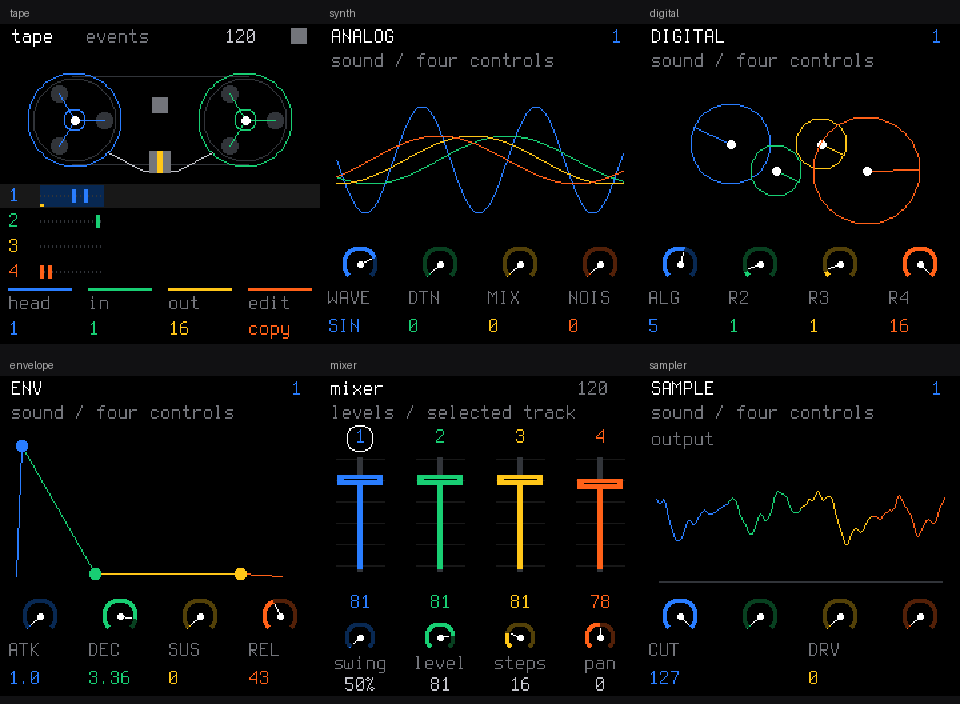
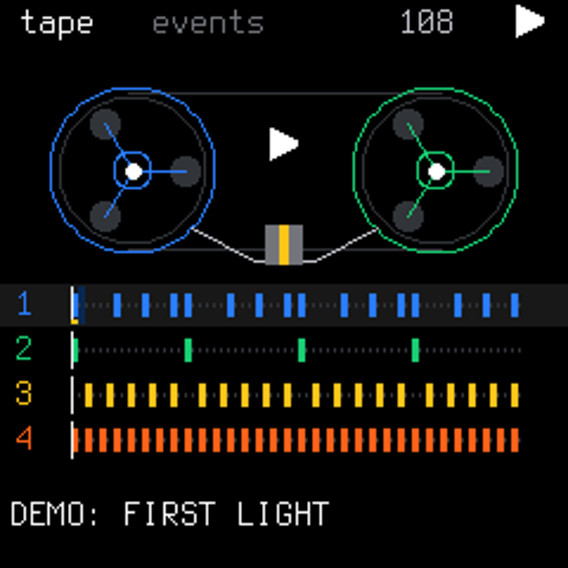

# ORBIT

**Make a beat, shape three synths, then rearrange their events on Tape.**

ORBIT is a four-track groovebox firmware for the **M-VAVE FM-1**: three synth parts and a drum machine, played through a color-coded Synth / Drum / Event Tape / Mixer workflow. Record a loop, turn it into a song, and keep your favorite sound controls together with user macros. Based on SLOOP/Felucca, with original ORBIT engines and graphics inspired by the original OP-1's four encoder roles.

[Install](#install) · [Get started](GUIDE.md#get-started) · [User guide](GUIDE.md) · [MIDI controllers](docs/MIDI-CONTROL.md) · [0.8.1 release notes](docs/releases/0.8.1.md) · [Try the native preview](#try-the-native-preview)

**0.8.1:** selected SLOOP 2.8 / 2.8.3 behavior fixes for SAMPLE retriggers, drum voices, live-held POLY notes, MIDI, layer pages and USB rescue, with credit to the SLOOP authors. The **FM-1** release retains ORP8/OPB3 storage. The device owner confirmed normal screen and basic playing operation after installation.



*Actual firmware UI rendered by the native host harness. These are earlier ORBIT screens, not hardware photographs or captures of 0.8.0.*

## Make a loop, then move its events

1. Select **track 4** with ALGORITHM and choose a drum kit with PRESETS. Press REC and play; on an empty project in free mode, press REC on the next downbeat to close the loop.
2. Select **track 1**, choose a sound, and record a bass line. Add chords or a melody on tracks 2 and 3.
3. Press **HOME** for Event Tape. Set the region with KNOB 2/3, choose COPY or LIFT with KNOB 4, and hold SEL while pressing OCT- to capture it. Set the destination with KNOB 1 and use SEL + OCT+ to drop it.
4. Press **GLO** for Mixer to balance the four tracks. Save variations into sections A-D and play or chain them with the SAVE layer.

Tape edits **sequencer events**, including notes, drum hits, timing, fills and parameter locks. It is not audio recording, PCM overdubbing or tape-speed playback. Drop overwrites destination events, so save a section before experimenting. See the [Tape controls](GUIDE.md#event-tape).

## What makes ORBIT its own instrument

- **Event Tape:** a four-track event timeline with reels, an inclusive selection and COPY / LIFT / DROP, alongside the step sequencer.
- **Original sounds:** SWARM's six detuned harmonic oscillators, PULSE's dual pulse/PWM synthesis, FM4's four sine operators, and **CLOUD**, an oscillator-source granular engine. CLOUD makes grains from oscillators; **GRAIN** makes grains from samples.
- **Controls that follow the sound:** four blue / green / white / orange encoders, one-index slow detents and accelerated fast turns through wide numeric ENV/LFO ranges, and an instant preset list that auditions each selection on Tape or Mixer.
- **User macros:** assign four destinations on **MACROS**, edit their values on **PERFORM** through EDIT/SELECT, and save the map with a USER sound or project. HOME remains Tape / Visualizer.
- **A real-firmware preview:** the native preview runs ORBIT's C sound engine, sequencer and display rather than a separate browser synth.

## Sounds and performance

| Area | What you can play and edit |
| --- | --- |
| Instruments | **17 engines, 189 factory sounds** in the default build: analog, FM, phase distortion, chip, sampler, formant, three-oscillator, organ, sample granular, SWARM, PULSE, FM4, FM6, PHYS, NOISE, CLUSTER and CLOUD |
| Tracks | **3 synth + 1 drum** multitimbrality; synth parts share **8 voices globally**, not eight each. Engine limits and CPU load also apply: CLUSTER at most **4** per part, CLOUD at most **3** |
| Sound design | ADSR and envelope destinations, tempo-synced envelopes and LFO, retrigger/free-running and bipolar/unipolar LFO, glide, voice modes and ANALOG LP/BP/HP filter |
| Sequencing | Up to 64 steps per track, four-note chords, ties, ratchets, swing, note length, step velocity, 24 parameter locks per track, microtiming and fill conditions |
| Live playing | Free or tempo recording, overdub, note repeat, one-key chords, mute/solo/fill, section chains, MIDI keyboard step entry and live drum mutes |
| Effects | Per-track **INSERT** with eight effect types and dry/wet; resonant LP/HP or BP track filter, slicer and sends; **27 punch-in effects**, REV/ECHO THROW and dotted delay; master DUST/DUCK/filter and a look-ahead limiter |
| Texture | A separate background bed: vinyl, tape, rain, wind, radio, room tone or USR sample, with tone, tempo movement and optional ducking |
| Your material | Four user sample slots, sample CHOP and drum-kit editing, SYN1-SYN4 drum synthesis, 32 USER sounds, four project/section slots and a 27-patch FM6 bank |
| Connections | USB MIDI, TRS MIDI IN, MIDI clock, sustain, pitch bend, Program Change and **16 persistent MIDI-learn slots**; stereo USB audio at 44.1 or 48 kHz |
| Editor | Sound and macro editing, piano roll, MIDI files, song arrangement, DX7 SysEx, samples, libraries and full backup/restore over Web MIDI |

CLUSTER uses a translated original OP-1 #246 oscillator core with 16 raw presets; pitch, envelope, velocity and effects are ORBIT's. Its four-voice cap is conditional on the shared budget and available CPU time, not a hardware polyphony guarantee. Read [CLUSTER's scope and limits](docs/OP1-CLUSTER.md).

On **FX > FILTER**, each synth track and the drum track have **FILT**, **RES** and **TYPE**. FILT keeps its -64..63 range and zero bypass. TYPE selects the original **LP/HP** behavior or **BP**, which sweeps the band's centre from low to high across the range. RES defaults to 40 out of 127, shown as about **31%**, matching the previous fixed resonance. This is separate from ANALOG's own filter and the master filter. See [track-filter controls](GUIDE.md#track-filter).

## Listen and explore

[Listen to FIRST LIGHT](docs/audio/orbit-first-light.mp3): an original four-bar, 108 BPM loop of FM4 bass, SWARM chords, PULSE melody and 808 drums, rendered by the C sequencer/DSP. [Hear the original engine examples](docs/audio/orbit-engines-0.3.mp3). These are host renders, not FM-1 recordings.

FIRST LIGHT is a historical host-rendered example. ORBIT 0.8.0 removes the built-in demo-song loader and DEMO SONG menu. Updating doesn't erase an earlier working autosave; use **NEW PROJECT** to clear it after saving any work you want to keep. See [projects and autosave](GUIDE.md#mixer-sections-and-projects).



## Install

The browser installation address is **[dspaudio.github.io/orbit](https://dspaudio.github.io/orbit/)**. Check the version shown by the installer before writing.

The site downloads the latest stable release automatically and validates its package before enabling **Connect**. Use Chrome or Edge, a USB data cable and a direct connection. Connect grants Web MIDI SysEx access; **Install** is a separate action after device preflight. Keep power and USB connected during the write. If the download fails, retry it; the page does not accept a local package picker.

**BACKUP before every update.** Stop playback and use the editor's Projects / Backup export. ORBIT 0.8.0 writes **ORP8 projects, still 3840 bytes, and OPB3 preset banks**. It imports ORP7 projects and OPB2/UPB1 banks with parameter-ID migration; legacy ORBIT projects remain readable, but raw SLOOP 2.6 **FUN6 is rejected**. Older firmware, including 0.7.0 and 0.7.1, cannot read the new formats, and its autosave may overwrite them. Keep a pre-update backup for a downgrade. See [storage and recovery](GUIDE.md#backup-updates-and-downgrades).

Local fallback for a verified package:

```sh
python3 -m pip install mido python-rtmidi
python3 tools/fm1_install.py --info
python3 tools/fm1_install.py build/orbit.fwsc
```

The source version is **ORBIT 0.8.1**, and the default FM-1 install identity remains **FM-1_900**. Use the default build command, **not `--release`**, whose upstream version scheme changes the identity and appends BETA. See [BUILDING.md](BUILDING.md) for the toolchain, local site generation and CLI instructions. The official v0.8.1 firmware assets are **`orbit.fwsc` and `SHA256SUMS` for FM-1**. Generated firmware packages are not committed to this tree.

**0.8.1 validation:** the full host suite, native preview, target build/budgets and web tests passed; all 218 renders match the reviewed goldens after six attributed changes. The separate `orbit_check.py` run returned 34 PASS / 1 FAIL (the known macOS IRQ compile limitation). Installation on 2026-10-28 reached 100%, restarted and returned `FM-1_900`. The device owner confirmed normal screen and basic playing operation and approved release; measured audio/timing, firmware-version query and physical OCT- rescue checks remain unverified. See the [validation record](docs/VALIDATION.md#orbit-081-release-package-2026-10-28).

**Historical 0.8.0 validation:** the final no-demo firmware passed the full host, native-preview and target checks, with **218 audio goldens unchanged**. On 2026-10-27, the no-demo **0.8 hardware candidate** completed the FM-1 write, reboot and identity check. The device owner confirmed a normal screen, cleared the earlier autosave with NEW PROJECT and accepted the hardware for release. INFO/PING timed out, so no successful firmware-version query is claimed. The version-only **0.8.0 rebuild has not been separately hardware-tested**. Earlier 0.7.1 software checks, 0.7.0 installation/version/PING checks and the 0.6.0 USB recording remain historical. Final hashes, resource measurements and detailed evidence belong in the [validation record](docs/VALIDATION.md).

**M-Vave SMK-37:** board support is merged, with model-specific source builds for SMK-37 Pro, SMK-37 Elite and MKE-P37. The port adds velocity keys/pads, fader banks, wheels and a pad sound picker. The feature list above describes the default FM-1 build: SMK-37 has only **USR1/USR2** sample storage and **no TRS MIDI IN**. Use a package for the matching model and read the [SMK-37 controls and safety instructions](SMK37.md). **The v0.8.1 release does not include SMK-37 binaries.**

## Try the native preview

Python 3, a C compiler and Pillow are required:

```sh
python -m pip install -r requirements.txt
python tools/orbit_preview.py --port 8080
```

Open http://127.0.0.1:8080 and press **Start audio**. The preview includes its own demo pattern; firmware boot does not load that preview pattern. Audio is buffered approximately 250-550 ms, project saves are **nonpersistent host doubles**, and sample upload is unsupported. Button taps work; held-button menus and layer combinations require the hardware. The separately deployed [WebAssembly emulator](https://dspaudio.github.io/orbit-web-emu/) is not automatically updated by this release.

## Documentation

- [GUIDE.md](GUIDE.md): panel workflow, recording, Event Tape, sound design, macros and saving.
- [MIDI control](docs/MIDI-CONTROL.md): channels, CC learn, MiniLab routing and controller limits.
- [BUILDING.md](BUILDING.md): build, local installer site and checks.
- [0.8.1 release notes](docs/releases/0.8.1.md), [0.8.0 release notes](docs/releases/0.8.0.md) and [validation record](docs/VALIDATION.md).
- Earlier releases: [0.7.1](docs/releases/0.7.1.md), [0.7.0](docs/releases/0.7.0.md), [0.6.0](docs/releases/0.6.0.md), [0.5.0](docs/releases/0.5.0.md), [0.4.1](docs/releases/0.4.1.md); [SLOOP 2.5 integration](docs/SLOOP-2.5-INTEGRATION.md).
- [Original ORBIT engines](docs/OP1-ENGINES.md), [CLUSTER](docs/OP1-CLUSTER.md), [design](DESIGN.md), [editor protocol](web/EDITOR_PROTOCOL.md) and [Dots](DOTS.md).

## Origin, credits and licensing

ORBIT began from the [isod89/sloop-fm1](https://github.com/isod89/sloop-fm1) v2.3 snapshot **d691ba7b2d922f1a1f41a3622cffe29ce41c5506**, not a fork retaining upstream history. SLOOP v2.4.1 and v2.5 changes were subsequently integrated; 0.7.0 brings the functional v2.6 changes from immutable commit **[d30d6553353373cf5506b9ed285fc4a2aa0c30ef](https://github.com/isod89/sloop-fm1/tree/d30d6553353373cf5506b9ed285fc4a2aa0c30ef)** while retaining ORBIT's registry, graphics and storage contract. The [original README](README-SLOOP.md) remains available.

Thanks to SLOOP's authors and community, and **[Felucca](https://github.com/hugelton/Felucca) by Leo Kuroshita (@kurogedelic) / Hügelton Instruments** for the synthesis, sequencing, editor and update foundations. Copyright (C) 2026 Leo Kuroshita (@kurogedelic), Hügelton Instruments; original notices are retained. Other credits include ChanceTheMaker and keremimo (MIDI input/clock), @renebohne (note lights/Program Change), Versilian Studios and Sonic Pi (CC0 samples), Terminus (SIL OFL), Fukiai (MIT), msfa/Dexed (FM6, Apache-2.0), DaisySP/Rings (PHYS) and the credited PHASE/VOICE references.

Code is **GPL-3.0-only**, with the existing msfa exception and asset notices: [LICENSE](LICENSE), [LICENSING.md](LICENSING.md). Distribute corresponding source with firmware. Extracted OP-1 tables and factory data retain **Teenage Engineering's original rights**; they are not CC0 or newly GPL-licensed assets, and extraction alone does not establish distribution permission. See [asset provenance and rights](assets/op1-cluster/README.md). ORBIT's graphics are original; no OP-1 logo or artwork is included. ORBIT is not affiliated with M-VAVE or teenage engineering. No warranty.
